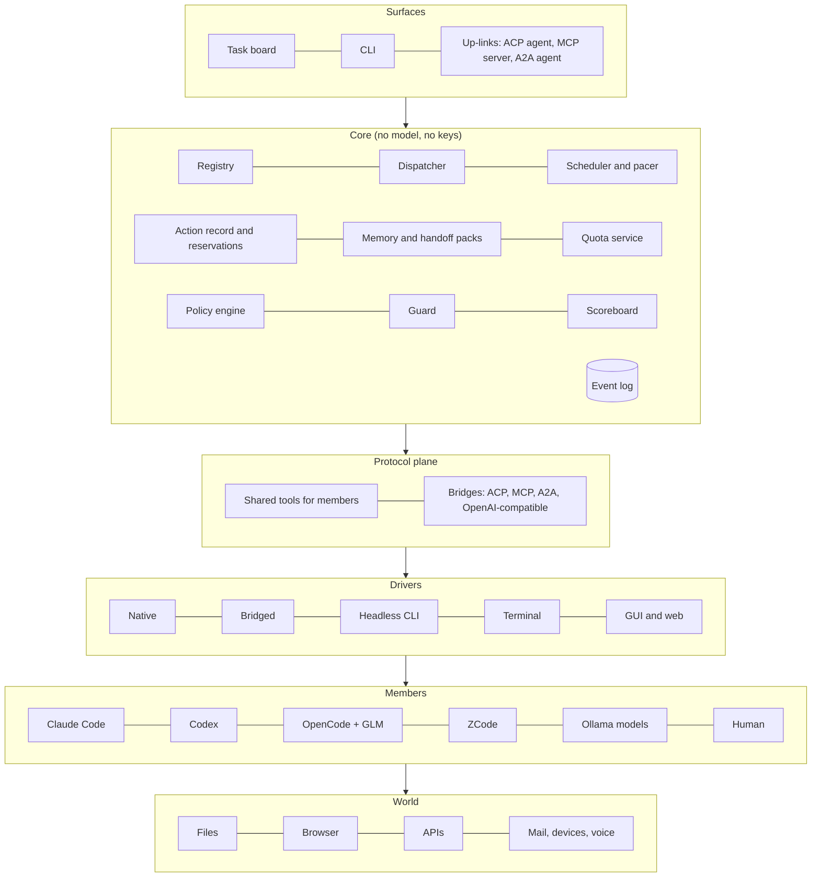
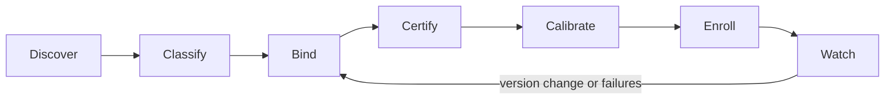
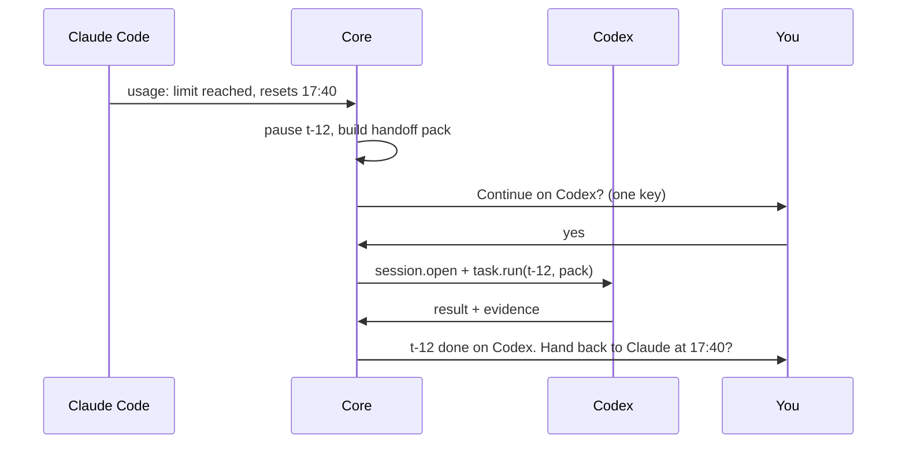
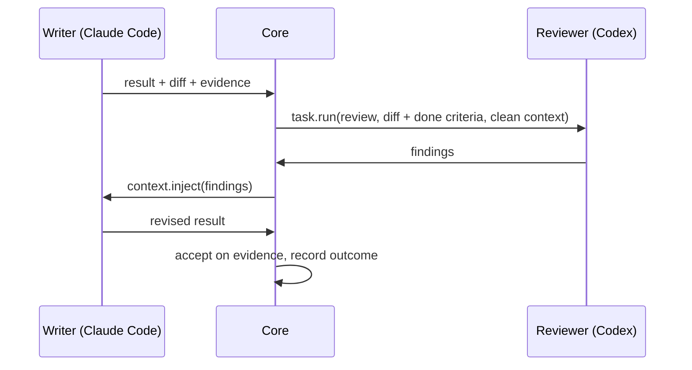
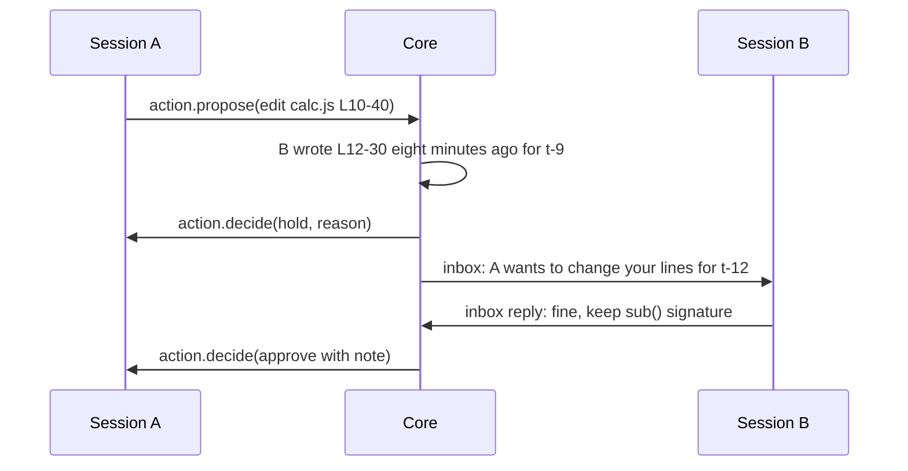

# Chariot: architecture

Status: design draft, 2026-10-12. Nothing built yet. Named Chariot on 2026-10-13: every agent is a harnessed horse, the chariot makes them pull one load, and you hold the reins.

One layer that every harness, model, SDK, tool, service and human can join, so they work as one team without stepping on each other. It never thinks for itself and never holds anyone's keys. It hands work to the best member, carries context between them, keeps every action on a shared record, and makes sure each subscription is only ever used through its own harness.

---

## 1. Design goals

1. **Anything can join.** A harness, a bare model, an SDK, a CLI, a TUI, a desktop app, a website, a script, a person. If it can take a request and give something back, it can be a member.
2. **Joining is cheap.** The smallest possible member implements one method. Everything above that is optional and unlocks more trust.
3. **No new standard war.** The protocol rides on existing transports and maps cleanly onto ACP, MCP and A2A. Anything that already speaks those joins with zero work.
4. **The protocol is teachable.** A harness can implement it natively, an adapter can translate for it, or a model can learn it in context from a skill file plus tools.
5. **Separation without git.** Safety comes from the action record and reservations on resources, not from worktrees. Worktrees and sandboxes are just one tool the layer can use.
6. **Plain, durable core.** No model inside the core. Intelligence is borrowed from members, so model churn never ages the core.
7. **Visible.** Every decision, handoff and action is on a timeline you can read, replay and overrule.
8. **Rules-clean.** Credentials never pass through the layer. Each subscription runs inside its own official harness at a human pace.
9. **Local-first, free to run.** One machine, one SQLite file, no hosted service required.

## 2. Glossary

| Term | Meaning | Your metaphor |
|---|---|---|
| Core | The governing layer. Plain machinery, no model, no keys | God |
| Member | Anything enrolled: harness, model, tool, service, human | Apostle |
| Manifest | A member's identity card: what it is, what it can do, how far it can be trusted | |
| Driver | Translator between a member's own interface and the protocol | Knowing every language |
| Task | A unit of work with a goal and a definition of done | Prayer |
| Result | What comes back, with evidence | Answer |
| Action | Any effect on the world: a diff, a command, a click, an email, an API call | Deed |
| Resource | Anything an action touches, named by a URI | |
| Reservation | A time-limited claim on a resource | |
| Handoff pack | The context that travels with a task between members | |
| Level | How deeply a member lets the core see and steer it (L0 to L4) | |

## 3. The big picture



Seven layers. Each talks only to its neighbours.

| Layer | Job |
|---|---|
| Surfaces | Where you and other tools interact: the board, the CLI, and up-links that let other tools use the whole council as one agent |
| Core | Decides who does what, keeps the record, holds memory, tracks quota, enforces policy |
| Protocol plane | The one language everything inside speaks, plus bridges to the outside protocols |
| Drivers | Translate each member's own interface into the protocol |
| Members | The things that actually do the work |
| World | What members act on: files, browser, APIs, mail, devices |
| Event log | Everything that happens, append-only, under all of it |

## 4. The protocol (working name Chariot/1)

### 4.1 Principles

- **Transport is borrowed.** JSON-RPC 2.0 over stdio, WebSocket or HTTP, the same as ACP and MCP. No new wire format.
- **Small required core, everything else optional.** A member declares what it supports in its manifest. The core adapts.
- **Semantics, not plumbing.** Chariot/1 defines meanings: task, result, action, resource, reservation, quota, evidence. Those are exactly what ACP, MCP and A2A leave undefined.
- **Maps both ways.** Every Chariot/1 concept has a defined mapping to ACP, MCP and A2A (section 4.7), so Chariot/1 can ship as an extension profile of those, not as a fifteenth standard.

### 4.2 Levels

A member is certified at the highest level it passes. Each level unlocks more privilege.

| Level | Name | Member must | Core grants |
|---|---|---|---|
| L0 | Hear | Take a task, return a result | Works in a sandbox copy. Output merged only after review |
| L1 | See | Stream structured events: messages, tool calls, usage | Same as L0, plus live timeline and better scoring |
| L2 | Gate | Propose each action and wait for a decision before doing it | May work in the shared workspace under reservations |
| L3 | Steer | Accept injected context and shared tools mid-session | Joins shared memory, inbox and reservations directly |
| L4 | Rewind | Checkpoint and roll back its own actions | May take irreversible-adjacent work with automatic undo |

From today's test: Claude Code over ACP reaches L2 (proposed diff and permission before each edit). OpenCode reaches L2 with "ask" permissions and also routes file writes through the client. Both can likely reach L3 because ACP lets the client hand MCP servers to a session.

### 4.3 The smallest possible member (L0)

One method:

```json
→ {"jsonrpc":"2.0","id":1,"method":"task.run",
   "params":{"task":{"goal":"Summarise README.md in 3 lines","done":"3 lines, no code"}}}
← {"jsonrpc":"2.0","id":1,
   "result":{"status":"done","content":[{"type":"text","text":"..."}]}}
```

That is enough to join. A shell script, a curl call to an API or a local model, a website driven by a browser driver, or a human answering in the board can all be L0 members.

### 4.4 Manifest

Every member has one. Declared fields come from the member or driver. Measured fields are written only by the core.

```json
{
  "id": "claude-code@max",
  "kind": "harness",
  "driver": {"tier": "bridged", "via": "acp", "command": "claude-agent-acp"},
  "level": {"declared": "L3", "certified": "L2"},
  "modalities": {"in": ["text","image","file"], "out": ["text","diff","file"]},
  "skills": ["code.write","code.review","plan","research.web"],
  "subscription": {"plan": "claude-max", "quota_source": "stream-limit-events", "pace": "human"},
  "cost": {"unit": "quota", "relative": 1.0},
  "trust": "standard",
  "measured": {"tasks": 0, "kept_rate": null, "median_latency_s": null}
}
```

Kinds: `harness`, `model`, `tool`, `service`, `human`, `council` (a group that presents as one member).

### 4.5 Messages

Core to member:

| Method | Purpose |
|---|---|
| `session.open` | Start a session with a workspace, tools and a handoff pack |
| `task.run` | Give a task. Required at every level |
| `task.cancel` | Stop |
| `context.inject` | Add context mid-task (L3) |
| `action.decide` | Approve, deny or modify a proposed action (L2) |
| `session.checkpoint`, `session.rollback` | L4 |

Member to core, streamed as events:

| Event | Purpose |
|---|---|
| `message` | Text, image, audio, file parts |
| `plan` | The member's own plan, if it shares one |
| `tool.call` / `tool.result` | What it is doing (L1) |
| `action.propose` | "I want to do this to that resource" with a preview, waits for `action.decide` (L2) |
| `action.done` | An action happened, with what changed |
| `usage` | Tokens, quota remaining, reset time |
| `ask` | The member needs a human or another member |
| `result` | Final output with evidence |

An action proposal:

```json
{"method":"action.propose","params":{
  "action_id":"a-91",
  "resource":"file:///repo/src/calc.js",
  "op":"edit",
  "preview":{"type":"diff","unified":"@@ -1,3 +1,3 @@ ..."},
  "reversible":true,
  "reason":"add sub() per task t-12"
}}
```

### 4.6 Resources

Every action names its target with a URI, which is how one record governs every modality:

| Scheme | Example | Undo |
|---|---|---|
| `file://` | `file:///repo/src/calc.js#L10-40` | Yes (snapshot) |
| `git://` | `git://repo/branch/main` | Yes |
| `shell://` | `shell://repo?cmd=npm%20test` | Depends on the command |
| `browser://` | `browser://profile-a/tab/3` | Partial |
| `http://` / `https://` | An API endpoint with a method | Usually no |
| `mail://` | `mail://outbox` | No |
| `db://` | `db://local/users` | With transactions |
| `device://` | `device://mic`, `device://screen` | n/a |

Reservations take a resource pattern, a mode (`read`, `write`, `exclusive`) and a time limit. Irreversible resources (mail, payments, public posts) always require an explicit decision, whatever the member's level.

### 4.7 Mapping to existing protocols

| Chariot/1 | ACP | MCP | A2A |
|---|---|---|---|
| `session.open` | `session/new` (with `mcpServers` for shared tools) | n/a | Task with `contextId` |
| `task.run` | `session/prompt` | `tools/call` on an agent-as-tool, or a Tasks extension task | `message/send` |
| `action.propose` + `action.decide` | `session/request_permission` (tool call carries the diff) | n/a | `input-required` state |
| File write through core | `fs/write_text_file` | n/a | Artifact |
| `message` / `tool.call` events | `session/update` | Progress notifications | Task status updates |
| `result` | Prompt response `stopReason` | Tool result | Completed task with artifacts |
| Manifest | `initialize` capabilities, `_meta` extension | Server capabilities | Agent Card plus an extension |

So a member that speaks ACP is Chariot/1 L2 through a thin bridge, an MCP agent-as-tool is L0 or L1, and an A2A agent is L0 or L1. Extra Chariot/1 fields travel in each protocol's own extension slot (`_meta` in ACP and MCP, extensions in A2A Agent Cards), so nothing breaks for tools that ignore them.

## 5. Three ways to teach the protocol

| Path | Who | How |
|---|---|---|
| Native | New harnesses and SDKs that want to join properly | A small SDK (TypeScript, Python, Rust) implementing Chariot/1 directly. Minimal member is about 30 lines |
| Translated | Everything that already exists | A driver (section 6). Nothing changes on the member's side |
| In context | Models and agents, even ones with no integration | A skill file plus shared tools injected at session start. The model learns the rules from text: claim before editing, report evidence, post to the inbox, write to memory |

The in-context path matters most for reach. Any harness that loads MCP servers and reads instruction files can follow Chariot/1 conventions without any code change, because the conventions live in the tools and the skill file:

```
chariot.claim(resource, mode, ttl)      reserve before you change something
chariot.release(resource)
chariot.memory.read(query) / chariot.memory.write(entry)
chariot.inbox.send(member, text) / chariot.inbox.read()
chariot.board.update(task_id, status, note)
chariot.handoff(task_id, to_skill, pack)
chariot.evidence(task_id, kind, ref)    tests run, sources, screenshots
```

**Tested 2026-10-12** (36 runs: Claude Code with Haiku 5.5 and Sonnet 5.5, OpenCode with a free model; a file reserved by another agent; normal and "urgent, finish everything" framing):

| Rules delivered through | Reserved file left alone | Reserved before editing | Messaged the holder | Reported evidence |
|---|---|---|---|---|
| Tool descriptions only | 5/18 | 5/18 | 5/18 | 5/18 |
| Skill file plus tools | **18/18** | **18/18** | **18/18** | 17/18 |

Lessons that change the design:

1. **Rules must travel in the instruction channel, not in tool descriptions.** Claude Code defers MCP tools: the model sees only their names until it searches for them, so rules written in descriptions never reached it (0/12). OpenCode loads descriptions eagerly and followed them 5/6. The core therefore delivers the rules through the instruction file (`CLAUDE.md`, `AGENTS.md`) or the session's system prompt, and keeps tool descriptions as backup.
2. **Urgency did not break compliance** once the rules were in the instruction channel. Agents finished the free part, refused the reserved part, messaged the holder, and told the user exactly what was blocked.
3. **Blocked agents poll.** Under pressure, one agent kept re-claiming the reserved file until the 300 s timeout. Chariot/1 needs `chariot.wait(resource)` (notify on release) and a rule: when blocked, finish the rest, report, and stop.
4. **A free model matched Sonnet** under the skill file, so the in-context path does not depend on a frontier model.
5. **Soft rules need a hard backstop.** Members that never received the rules violated almost every time. In-context teaching is the soft layer; L2 gating in the core remains the enforcement layer.

**Live two-agent test, 2026-10-12** (18 trials: Claude Code with Sonnet 5.5 via headless CLI and OpenCode with a free model via ACP, working on the same repo at the same time; compatible tasks and directly contradicting tasks; baseline, soft rules, and soft rules plus a hard gate):

| | Baseline | Soft rules | Soft + hard gate |
|---|---|---|---|
| One agent's entire work silently wiped | 2/6 | 0/6 | 0/6 |
| Contradiction surfaced to the human (contradicting tasks) | 0/3 | 3/3 | 2/3 |
| At least one false "done" report (contradicting tasks) | 3/3 | 3/3 | 3/3 |
| Median time to both finished | 27 s | ~42 s | ~40 s |

Lessons that change the design:

1. **The incident is real and the protocol fixes it.** Without the protocol, OpenCode overwrote Claude's whole refactor in 2 of 6 trials while Claude reported success. With it, zero.
2. **Locks cannot settle contradictions.** When two tasks genuinely contradict, whoever writes last wins. The core must detect conflicting goals at intake and route the decision to the human, not leave it to members.
3. **Member reports go stale.** The member that finishes first reports a state the next member then changes. The core must run a final acceptance pass: after all members finish, re-check every task's done criteria on the final state and report that truth, not the members' summaries.
4. **The hard gate added no value over soft rules here** and serialised the agents, so the last writer decided silently in 2 of 3 contradicting trials. Keep it as a backstop for members that never received the rules, not as the main mechanism.
5. **Harness built-ins already block simple stale writes** (both refuse to write a file changed since read). The damage comes from agents acting on different intent, not from byte-level races.

**Intake, acceptance and onboarding tests, 2026-10-12:**

| Test | Result |
|---|---|
| Intake contradiction check on 36 blind-authored task pairs (14 contradict, 14 same-area compatible, 8 disjoint) | Haiku 5.5: caught 14/14, wrongly flagged 1/14 compatible (a defensible one), 0/8 disjoint, ~5 s. Free model: 13/14 (the miss was an unparsed reply), 0 false flags |
| Same check on the live trial tasks | Explicit contradiction flagged 6/6. The "compatible" pair, which had in fact undone each other's literal requirements, was flagged 3/3 by Haiku and 1/3 by the free model |
| Final acceptance pass on the 36 task outcomes from the live trials | Every agent reported done. 17/36 were not literally done. Haiku verifier caught 17/17 with 2 false alarms on 19 real passes (both on an ambiguous edge case). Never tampered with code |
| Onboarding from `--help` only (Claude Code, OpenCode, a local Ollama model) | Agent-written driver specs passed conformance 3/3 on the first attempt with no human edits. Both harnesses reached L1. It also found Claude Code's `rate_limit_event` stream event, the quota meter's input |

Design consequences:

1. Intake runs every new task against every in-flight task through a cheap judge member before dispatch. A flag goes to the human with the question to decide; members never settle contradictions.
2. Acceptance belongs to the core. Done criteria are checked literally against the final state by an independent verifier member after all members finish, and the board shows that verdict, not the members' summaries.
3. Onboarding is the default path, not a fallback. `chariot add <thing>` runs the onboarding agent, then conformance, then enrollment.

For a bare model with no harness at all (an API key, a local Ollama model), the core runs it inside a minimal reference harness so it can still be a member.

## 6. Drivers

### 6.1 Tiers

| Tier | Member speaks | Driver does | Typical level reached |
|---|---|---|---|
| Native | Chariot/1 | Nothing | Up to L4 |
| Bridged | ACP, MCP, A2A, OpenAI-compatible HTTP | Protocol mapping (section 4.7) | ACP: L2 to L3. MCP and A2A: L0 to L1 |
| Headless CLI | JSON or text from a non-interactive mode | Starts the process, maps output lines to events | L1, sometimes L2 through hooks |
| Terminal | An interactive TUI | Runs it in a virtual terminal, types input, reads the screen | L0 to L1 |
| GUI and web | A desktop app or website | Accessibility tree and screenshots | L0 |

Below every tier sits the watcher: the member runs in its own sandbox copy and the core diffs what changed. So even a member the core cannot understand is still governed by its effects.

### 6.2 Drivers are data first

Most drivers should be a declarative spec, not code. That keeps them easy to generate, review and repair:

```yaml
driver: codex-exec
tier: headless
start: ["codex", "exec", "--json", "{prompt}"]
cwd: "{workspace}"
events:
  - match: {type: "agent_message"}      emit: message
  - match: {type: "exec_command_begin"} emit: tool.call
  - match: {type: "patch_apply_begin"}  emit: action.done
  - match: {type: "token_count"}        emit: usage
result: {match: {type: "task_complete"}}
quota:
  signals: ["rate_limit", "usage limit"]
```

Code escape hatches exist for odd cases, and they run sandboxed with no access to credentials.

### 6.3 The onboarding pipeline



| Step | What happens |
|---|---|
| Discover | Scan for candidates: binaries on PATH, harness config folders, running Ollama, the ACP registry, MCP configs, anything you point it at |
| Classify | Work out what the candidate speaks: Chariot/1, ACP, MCP, A2A, OpenAI-compatible, headless CLI, TUI, GUI |
| Bind | Use an existing bridge if one fits. Otherwise the onboarding agent (itself a member) reads the docs and `--help`, probes in a sandbox, and writes a driver spec |
| Certify | Run the conformance suite in a scratch workspace. The certified level is the highest one passed |
| Calibrate | A placement exam built from your own history: tasks you already did, with known good outcomes. This seeds the scoreboard, so a new member does not start blind |
| Enroll | Manifest written to the registry. The member shows up on the board |
| Watch | Detect version changes and rising failure rates. Re-certify, repair the driver, or quarantine the member until fixed |

Target experience: `chariot add <anything>` and about two minutes later the member is enrolled with a certified level and a first score.

### 6.4 Conformance suite

| Level | Checks |
|---|---|
| L0 | Starts, takes a task, returns a result, can be cancelled, times out cleanly |
| L1 | Streams events in order. Tool calls and usage map correctly |
| L2 | Proposes before acting. A denied action does not happen. A modified action happens as modified |
| L3 | Uses injected tools. Respects a reservation it did not take. Reads injected context |
| L4 | Rolls back to a checkpoint and the workspace matches byte for byte |

## 7. The core

| Component | Job | Notes |
|---|---|---|
| Registry | Members, manifests, levels, health | Source of truth for who exists |
| Dispatcher | Suggests or picks the member for a task | Inputs: skill match, scoreboard, quota left, cost, level, your rules. Starts in suggest mode. Auto mode is earned per task kind once its picks beat yours |
| Scheduler and pacer | Queue, concurrency, per-subscription pace | Keeps each subscription at human-like rates |
| Action record and reservations | Every proposed and done action, all reservations, revert detection | Holds an edit that removes another member's recent lines and explains why to both |
| Memory | Project memory, decisions and why, handoff packs | Writes pass through the guard. Readable by every L3 member |
| Quota service | Live limit windows per subscription | Reads `usage` events and limit signals from drivers. Triggers failover |
| Scoreboard | Outcomes per member per task kind | Collected without grading: work kept after 7 days, tests passed, reviewer findings, your reverts |
| Policy engine | What needs approval, per resource and per member | Example: anything `mail://` or `https://` POST always asks you |
| Guard | Screens content crossing between members | Prompt injection checks on memory writes and on outputs passed as another member's input |
| Sandbox manager | Copy-on-write workspaces, snapshots around shell commands, containers for low-level members | Git worktrees are one backend among several |
| Event log | Append-only record of everything | Powers the board timeline, replay and "why did it pick that" |

### 7.1 Task contract

```json
{
  "task_id": "t-12",
  "goal": "Add sub() to calc.js with tests",
  "done": ["tests pass", "no change outside src/ and test/"],
  "skills": ["code.write"],
  "resources": [{"uri":"file:///repo/src/**","mode":"write"},{"uri":"file:///repo/test/**","mode":"write"}],
  "budget": {"quota": "low", "time_s": 900},
  "handoff": {
    "summary": "...",
    "done_so_far": "...",
    "current_diff": "...",
    "decisions": [{"what":"...","why":"..."}],
    "open_questions": ["..."]
  },
  "review": {"by": "different-model", "required": true}
}
```

The result carries `status`, `content`, `evidence` (tests run, sources, screenshots), `actions` (ids from the record) and `usage`.

### 7.2 Core flows

**Quota failover**



**Write, then cross-review**



**Parallel safety**



## 8. Surfaces and up-links

| Surface | What it is |
|---|---|
| Task board | The main view. Tasks, who has them, live timeline, holds waiting on you, quota bars |
| CLI | `chariot add`, `chariot run`, `chariot board`, `chariot why <task>` |
| ACP up-link | The whole council appears as one ACP agent inside Zed, JetBrains or any ACP client |
| MCP up-link | Any harness can call the council as tools: `council.run`, `council.review` |
| A2A up-link | Remote agents and other machines can send tasks in |

The up-links are what make this a platform rather than another window. Other tools become storefronts for it.

## 9. Security and rules

- **No credentials in the core.** Members log in through their own harness. The core never sees or stores a token.
- **Official surfaces for subscriptions.** Subscription-backed members are driven only through official modes (ACP adapters, headless CLI). Consumer websites are never driven on a subscription.
- **Human pace.** The pacer caps concurrency and request rate per subscription.
- **Generated drivers are untrusted.** They run sandboxed, with no network except the member's own, and no access to credentials.
- **Guarded crossings.** Content passed between members or written to memory goes through the guard.
- **Irreversible means ask.** Mail, payments, public posts and other irreversible actions always come to you.

## 10. Data and storage

One SQLite database plus an append-only event log, all local:

`members`, `manifests`, `drivers`, `tasks`, `handoffs`, `actions`, `reservations`, `memory`, `quota_windows`, `outcomes`, `events`

## 11. Known risks and answers

| Risk | Answer in this design |
|---|---|
| A new protocol nobody adopts | Adoption is not required. Bridges and drivers cover everything, and Chariot/1 ships as extension profiles of ACP, MCP and A2A |
| Vendors break drivers | Drivers are data, certified on every version change, repaired by the onboarding agent, quarantined if broken |
| Vendors flag automated use | Official surfaces only, human pace, no token handling |
| Routing barely beats one strong agent | The dispatcher suggests by default. Auto mode is earned per task kind with evidence. The core's value does not depend on routing: failover, review and safety stand alone |
| Handoffs lose the reasoning | Handoff packs carry decisions and why. One writer per resource. Reviewers get a clean context on purpose |
| Hard to debug across layers | One event log per task, one timeline view, `chariot why` |
| Cold start for scores | The calibration exam from your own history |
| Shared tools become an injection hub | The guard on every crossing, and the policy engine on what injected tools may do |
| Latency of handoffs | Warm sessions kept open per member. Handoffs only at task boundaries |

## 12. Build order (when we decide to build)

1. Chariot/1 types, event log, registry.
2. Bridged drivers: Claude Code and OpenCode over ACP, Codex over ACP or headless.
3. Task board (read-only timeline first).
4. Quota service and failover.
5. Cross-review flow.
6. Action record, reservations, revert detection.
7. Shared tools over MCP, injected into L3 members.
8. Scoreboard and calibration exam.
9. Onboarding agent, driver specs, conformance suite.
10. Up-links: ACP, then MCP, then A2A.
11. Terminal and GUI driver tiers.
12. Dispatcher auto mode, per task kind, once earned.

## 13. Open questions

- How each harness reports quota. Needs a check per member.
- Where ZCode and Antigravity land in the driver tiers.
- Whether the dispatcher ever uses a small local model to classify tasks, or stays pure rules.
- The board's form: terminal, local web page, or a panel inside existing tools.
- Names: the project, the protocol, and the levels.
